# Arquitetura Técnica do Sistema — Tecno System Service Desk

Este documento detalha as decisões estruturais, modelo de dados, políticas de segurança, fluxo de componentes e padrões de engenharia adotados na evolução do **Tecno System Service Desk**.

---

## 1. Visão Geral e Filosofia Arquitetural

O sistema é estruturado como uma **Single-Page Application (SPA) reativa e progressiva (PWA)** integrada diretamente a um backend gerenciado **Supabase (PostgreSQL 17 com RLS)**.

### Pilares Fundamentais:
1. **Segurança em Primeiro Lugar (Zero-Trust & RLS)**: O banco de dados PostgreSQL é a raiz de confiança. 100% das consultas passam por Row Level Security (RLS), garantindo isolamento total entre departamentos e controle rigoroso de privilégios.
2. **Consistência Atômica via RPCs**: Transições de status e atribuição de responsáveis são executadas como transações ACID atômicas no PostgreSQL.
3. **Submissão Atômica de Anexos em 2 Fases**: O chamado é persistido primeiro gerando o ID definitivo; os arquivos são transmitidos em seguida vinculados ao ID, suportando reenvio pontual de falhas sem criar registros órfãos.
4. **Isolamento Setorial dos 4 Departamentos**: As operações da empresa júnior são organizadas exclusivamente em **Financeiro**, **RH**, **Marketing** e **Projetos**.

---

## 2. Mapa e Hierarquia de Componentes

```mermaid
graph TD
    App["App (Root Orchestrator)"]
    AuthGuard["AuthScreen (Auth Guard)"]
    Sidebar["Sidebar (Slide Drawer - 10 Itens)"]
    Header["Header (Notificações Realtime & CTA)"]

    App --> AuthGuard
    App --> Sidebar
    App --> Header

    subgraph "Telas e Módulos Principais"
        Overview["OverviewView (Visão Geral das Solicitações)"]
        Unified["UnifiedTicketsView (Chamados: Lista | Kanban)"]
        MyTickets["MyTicketsView (Meus Chamados: Atribuídos / Abertos)"]
        Executive["ExecutiveDashboardView (Painel Executivo & Métricas)"]
        Workspace["PersonalWorkspaceView (Espaço Privado)"]
        Calendar["CalendarView (Calendário Corporativo)"]
        Audit["AuditView (Trilha de Auditoria & 403 Guard)"]
        Settings["SettingsView (Aparência, Perfil & Segurança)"]
    end

    App --> Overview
    App --> Unified
    App --> MyTickets
    App --> Executive
    App --> Workspace
    App --> Calendar
    App --> Audit
    App --> Settings

    subgraph "Gavetas e Modais Globais"
        Drawer["TicketDetailsDrawer (Detalhes, SLA, Comentários & Anexos)"]
        ModalNew["TicketFormModal (Novo Chamado com Upload & Ctrl+V)"]
        ModalUser["UserManagementModal (Gestão de Colaboradores)"]
        ModalPwd["ChangePasswordModal (Troca de Senha)"]
    end

    App --> Drawer
    App --> ModalNew
    App --> ModalUser
    App --> ModalPwd
```



---

## 3. Modelo de Dados e Migrations

A evolução introduziu a migration `20261027000005_update_departments_and_sidebar_rbac.sql` com as seguintes definições:

### 3.1 Departamentos Oficiais
A tabela `departments` opera exclusivamente com os 4 códigos oficiais:
- `FIN` (Financeiro)
- `RH` (Recursos Humanos)
- `MKT` (Marketing)
- `PRJ` (Projetos)

### 3.2 Novas Permissões RBAC na Tabela `roles`
- `audit.view`: Concedida a **Presidente** e **Diretor** (controla visualização de histórico e logs).
- `ticket.assign`: Concedida a **Presidente** e **Diretor** (controla a atribuição de responsáveis).
- `profile.change_department`: Concedida exclusivamente ao **Presidente**.

### 3.3 Trigger de Proteção de Departamento (`trg_check_profile_department_change`)
```sql
CREATE OR REPLACE FUNCTION check_profile_department_change()
RETURNS TRIGGER AS $$
BEGIN
  IF NEW.department_id IS DISTINCT FROM OLD.department_id THEN
    IF NOT is_president(auth.uid()) THEN
      RAISE EXCEPTION 'Apenas o Presidente possui permissão para alterar o departamento de um colaborador.';
    END IF;
  END IF;
  RETURN NEW;
END;
$$ LANGUAGE plpgsql SECURITY DEFINER;
```

### 3.4 Bucket `avatars` no Supabase Storage
- Bucket público para leitura de fotos de perfil (`public = true`).
- Políticas RLS vinculadas a `{user_id}/*`, permitindo que cada usuário envie e altere apenas o seu próprio avatar.

---

## 4. Matriz de Acesso e Permissões (RBAC)

| Recurso / Ação | Membro | Diretor | Presidente | Cliente |
| :--- | :---: | :---: | :---: | :---: |
| **Visão Geral das Solicitações** | Apenas Setor | Apenas Setor | Global (Todos) | Bloqueado |
| **Chamados (Lista / Kanban)** | Apenas Setor | Apenas Setor | Global (Todos) | Apenas Próprios |
| **Filtro de Departamento** | Oculto | Oculto | **Exclusivo** | Oculto |
| **Meus Chamados** | Sim | Sim | Sim | Sim |
| **Painel Executivo & Métricas** | Apenas Setor | Apenas Setor | Global (Filtro Ativo) | Bloqueado |
| **Auditoria (`audit.view`)** | **403 Bloqueado** | Apenas Setor | Global Completa | **403 Bloqueado** |
| **Exclusão de Chamados** | Não | Sim (Setor) | Sim (Global) | Não |
| **Atribuição de Responsável** | Não | Sim | Sim | Não |
| **Alteração de Departamento** | Bloqueado por Trigger | Bloqueado por Trigger | **Permitido** | Bloqueado por Trigger |
| **Upload de Anexos no Ticket** | Sim (Max 1MB, 5 arquivos) | Sim | Sim | Sim |
