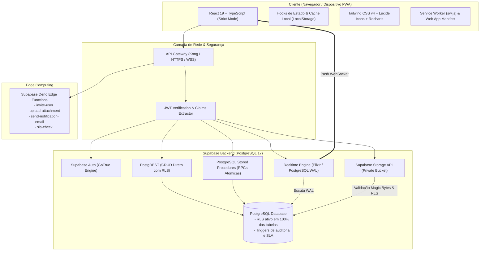
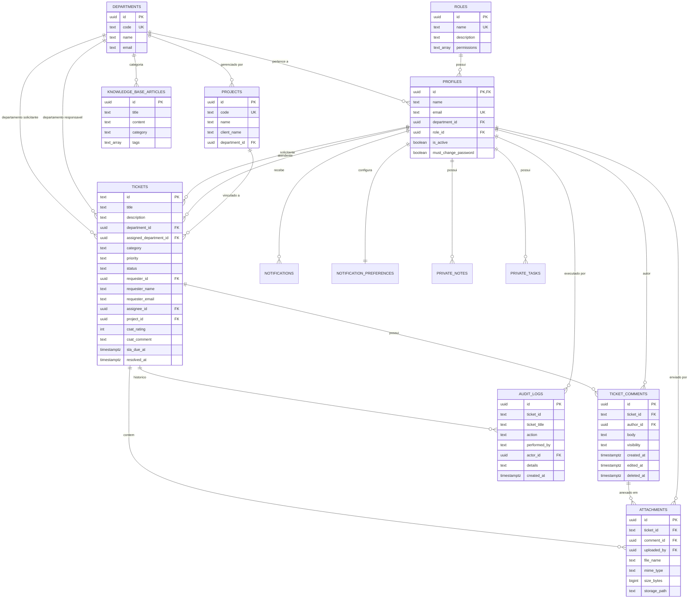

# Arquitetura Técnica do Sistema — Tecno System Service Desk

Este documento detalha as decisões estruturais, modelo de dados, políticas de segurança, fluxo de comunicação e padrões de engenharia adotados no desenvolvimento e evolução do **Tecno System Service Desk**, a plataforma unificada de suporte, atendimento e gestão de demandas da empresa júnior.

---

## 1. Visão Geral e Filosofia Arquitetural

O sistema foi arquitetado como uma **Single-Page Application (SPA) moderna, reativa e progressiva (PWA)** alimentada diretamente por uma infraestrutura **Serverless e BaaS corporativa (Supabase)**, sem camadas intermediárias legadas (como monolitos Express/Nest).

### Pilares Fundamentais:
1. **Segurança em Primeiro Lugar (Zero-Trust & RLS)**: O banco de dados PostgreSQL é a raiz de confiança. Nenhuma requisição burla o Row Level Security (RLS), garantindo isolamento absoluto de dados entre departamentos e perfis.
2. **Consistência Atômica via RPCs**: Operações com regras de transição complexas (mudança de status com cálculo de carga e auditoria) são executadas no PostgreSQL como transações atômicas ACID.
3. **Comunicação em Tempo Real Bidirecional**: WebSocket nativo (`supabase-js` realtime) propaga atualizações de tickets, novos comentários e notificações instantaneamente sem necessidade de polling manual.
4. **Resiliência e PWA**: Shell offline com Service Worker (`sw.js`), Web App Manifest instalável e compatibilidade com dispositivos móveis.
5. **Zero Leaks & Zero Hardcoded Passwords**: Toda autenticação é gerenciada pelo Supabase Auth (GoTrue) com criptografia bcrypt/argon2, e credenciais sensíveis residem estritamente em variáveis de ambiente (`.env`).

---

## 2. Diagrama Arquitetural de Sistema

---

## 3. Modelo Relacional de Dados (Diagrama E-R)

---

## 4. Modelo de Segurança (Defense-in-Depth)

### 4.1. Row Level Security (RLS)
Todas as tabelas possuem `ALTER TABLE ... ENABLE ROW LEVEL SECURITY`. As políticas são avaliadas pelo próprio PostgreSQL no contexto do usuário autenticado (`auth.uid()`):

| Tabela | Operação | Regra de Autorização |
|---|---|---|
| `tickets` | SELECT | `Presidente` vê todos; `Diretor` e `Membro` veem seu departamento (`department_id` ou `assigned_department_id`); `Cliente` vê estritamente os seus (`requester_id = auth.uid()`). |
| `tickets` | INSERT | Usuários autenticados podem abrir chamados; `Cliente` restrito a `requester_id = auth.uid()`. |
| `tickets` | UPDATE | Solicitante pode editar se aberto; Atendentes do departamento responsável podem atuar; Presidente pode editar globalmente. |
| `ticket_comments` | SELECT | Comentários públicos visíveis a quem tem acesso ao ticket; Notas internas (`visibility = 'internal'`) filtradas para membros da empresa (exclui `Cliente`). |
| `attachments` | SELECT | Restrito a tickets visíveis; URLs são assinadas (`createSignedUrl`) com expiração de 1 hora. |
| `notifications` | SELECT / UPDATE | Estritamente o destinatário (`user_id = auth.uid()`) ou remetente (`sender_id = auth.uid()`). |
| `audit_logs` | SELECT | Restrito a usuários com permissão de auditoria (`audit.view` ou `Presidente`). Imutável (sem UPDATE/DELETE). |

### 4.2. Controle de Acesso Baseado em Função (RBAC)
Os cargos possuem arrays de permissões granulares:
- `Presidente`: Acesso irrestrito (`ticket.view_all`, `ticket.delete`, `user.manage`, `audit.view`, `sla.manage`).
- `Diretores`: Gestão de chamados e membros do seu respectivo departamento (`ticket.view_dept`, `ticket.delete_dept`, `ticket.reassign`, `comment.create_internal`).
- `Membros`: Abertura e atendimento operacional de chamados (`ticket.view_dept`, `ticket.update`, `comment.create`).
- `Cliente`: Acesso seguro exclusivo ao Portal do Cliente (`ticket.view_own`, `ticket.create`, `comment.create`).

### 4.3. Validação Binária de Anexos (Magic Bytes)
Para impedir upload de executáveis maliciosos disfarçados de imagem ou PDF, o sistema valida a assinatura binária dos arquivos antes do envio:
- **PNG**: `89 50 4E 47 0D 0A 1A 0A`
- **JPEG**: `FF D8 FF`
- **PDF**: `%PDF-` (`25 50 44 46 2D`)
- **Tamanho Máximo**: 1 MB por arquivo, com sanitização de nomes para caracteres seguros.

---

## 5. Arquitetura de Comunicação e Realtime

### 5.1. RPCs Atômicas no PostgreSQL
Para evitar inconsistências (race conditions) entre requisições concorrentes:
1. `transition_ticket_status`: Valida o grafo de transições permitidas (`Aberto` -> `Em Andamento` -> `Pendente` -> `Resolvido` -> `Fechado`), pausa o relógio de SLA se `Pendente`, calcula data de resolução se `Resolvido` e grava na trilha de auditoria em uma única transação ACID.
2. `assign_ticket_atomic`: Atribui ou reatribui membro responsável e recalcula instantaneamente a carga de trabalho do atendente (`active_tickets_count`).
3. `reopen_ticket`: Permite a reabertura de chamados fechados dentro da janela estrita de 7 dias, restaurando o status para `Em Andamento` e registrando justificativa.
4. `submit_csat_feedback`: Registra avaliação de 1 a 5 estrelas do cliente, garantindo que apenas chamados resolvidos/fechados sejam avaliados.
5. `anonymize_user_data`: Executa anonimização de dados pessoais (Art. 18 LGPD), pseudonimizando nome e e-mail e preservando métricas históricas.

### 5.2. Canais Supabase Realtime
A interface reage instantaneamente aos eventos de banco via canais WebSocket:
- `ticket-comments-{ticketId}`: Novos comentários, edições e anexos refletem na timeline em < 100ms.
- `user-notifications-{userId}`: Alertas de menção (@), reatribuição e advertências de SLA atualizam o contador não lido no cabeçalho em tempo real.

---

## 6. Diferenciais da Empresa Júnior

1. **Gestão de Projetos Integrada**: Chamados podem ser vinculados a consultorias e clientes da empresa júnior (ex: `PRJ-ERP-01`).
2. **Avaliação CSAT Nativa**: Métrica de satisfação do cliente coletada no momento da entrega do suporte.
3. **Base de Conhecimento (Knowledge Base)**: Guias rápidos, tutoriais de acesso e políticas corporativas indexados por tags e busca contextual.
4. **Exportação de Calendário iCalendar (.ICS)**: Download de agenda no padrão RFC 5545 compatível com Google Calendar, Outlook e Apple Calendar.
5. **Privacidade e LGPD**: Botão de Direito ao Esquecimento para ex-membros e clientes, com registro em log de conformidade.
6. **Progressive Web App (PWA)**: Totalmente instalável no smartphone ou desktop com splash screen personalizada e suporte offline.

---

## 7. Registros de Decisões de Arquitetura (ADR)

### ADR 001: Arquitetura Direta Supabase sem Servidor Intermediário
- **Decisão**: Conectar o frontend React diretamente ao Supabase via `supabase-js`, PostgREST e Edge Functions.
- **Justificativa**: Elimina overhead de manutenção de um servidor Node/Express/Nest intermediário, reduz latência de rede pela metade e aproveita as garantias nativas de segurança do PostgreSQL RLS.

### ADR 002: Tailwind CSS v4 para Estilização
- **Decisão**: Adotar a engine de alto desempenho do Tailwind CSS v4 via `@tailwindcss/vite`.
- **Justificativa**: Compilação ultrarrápida no Vite, sem necessidade de `tailwind.config.js` redundante, com design system baseado em CSS variables nativas e suporte contínuo ao modo escuro (`dark:`).

### ADR 003: Validação em Duas Camadas (Zod no Frontend + Check Constraints no PostgreSQL)
- **Decisão**: Validar formulários na UI com esquemas Zod antes do envio e aplicar constraints estritas no banco de dados (`CHECK (status IN (...))`, `CHECK (size_bytes <= 1048576)`).
- **Justificativa**: Feedback imediato para o usuário com validação visual e garantia absoluta de integridade relacional no banco.
