# Arquitetura Técnica do Sistema — Tecno System Service Desk

Este documento detalha as decisões estruturais, modelo de dados, políticas de segurança, fluxo de componentes e padrões de engenharia adotados na evolução do **Tecno System Service Desk**.

---

## 1. Visão Geral e Filosofia Arquitetural

O sistema é estruturado como uma **Single-Page Application (SPA) reativa e progressiva (PWA)** integrada diretamente a um backend gerenciado **Supabase (PostgreSQL 17 com RLS)**.

### Pilares Fundamentais:
1. **Segurança em Primeiro Lugar (Zero-Trust & RLS)**: O banco de dados PostgreSQL é a raiz de confiança. 100% das consultas passam por Row Level Security (RLS), garantindo isolamento total entre departamentos e controle rigoroso de privilégios.
2. **Consistência Atômica via RPCs**: Transições de status e atribuição de responsáveis são executadas como transações ACID atômicas no PostgreSQL.
3. **Submissão Atômica de Anexos em 2 Fases**: O chamado é persistido primeiro gerando o ID definitivo; os arquivos são transmitidos em seguida vinculados ao ID, suportando reenvio pontual de falhas sem criar registros órfãos.
4. **Isolamento Setorial dos 4 Departamentos**: As operações da empresa júnior são organizadas exclusivamente em **Financeiro**, **RH**, **Marketing** e **Projetos**.

---

## 2. Mapa e Hierarquia de Componentes

```mermaid
graph TD
    App["App (Root Orchestrator)"]
    AuthGuard["AuthScreen (Auth Guard)"]
    Sidebar["Sidebar (Slide Drawer - 13 Itens)"]
    Header["Header (Avatar 40px, Dropdown & Mobile CTA)"]

    App --> AuthGuard
    App --> Sidebar
    App --> Header

    subgraph "Telas e Módulos Principais"
        Overview["OverviewView (Visão Geral das Solicitações)"]
        Unified["UnifiedTicketsView (Chamados: Lista | Kanban)"]
        MyTickets["MyTicketsView (Meus Chamados: Atribuídos / Abertos)"]
        Notif["NotificationsView (Central de Notificações)"]
        Executive["ExecutiveDashboardView (Painel Executivo & Métricas)"]
        People["PeopleView (Módulo de Pessoas - RH)"]
        Finance["FinanceView (Módulo Financeiro)"]
        Workspace["PersonalWorkspaceView (Espaço Privado)"]
        Calendar["CalendarView (Calendário Corporativo)"]
        Audit["AuditView (Trilha de Auditoria & 403 Guard)"]
        Settings["SettingsView (Aparência, Perfil & Segurança)"]
    end

    App --> Overview
    App --> Unified
    App --> MyTickets
    App --> Notif
    App --> Executive
    App --> People
    App --> Finance
    App --> Workspace
    App --> Calendar
    App --> Audit
    App --> Settings

    subgraph "Gavetas e Modais Globais"
        Drawer["TicketDetailsDrawer (Detalhes, SLA, Comentários & Anexos)"]
        ModalNew["TicketFormModal (Novo Chamado com Upload & Ctrl+V)"]
        ModalUser["UserManagementModal (Gestão de Colaboradores)"]
        ModalPwd["ChangePasswordModal (Troca de Senha)"]
    end

    App --> Drawer
    App --> ModalNew
    App --> ModalUser
    App --> ModalPwd
```

---

## 3. Modelo de Dados e Migrations

### 3.1 Migration `20261027000006_vice_president_departments_and_permissions.sql`
A evolução introduziu suporte à liderança executiva e aos módulos de gestão:

1. **Departamento Executivo (`Administração`)**:
   - `departments.is_executive_department = true` para Administração.
   - O Presidente e o Vice-presidente pertencem a este departamento.
2. **Cargo `Vice-presidente`**:
   - Ordem hierárquica oficial: Presidente > Vice-presidente > Diretor > Membro.
   - Funções auxiliares PostgreSQL: `is_executive(user_id)` concede privilégios executivos irrestritos a Presidente e Vice-presidente.
   - Subtítulo oficial: `"Vice-presidente · Administração e Diretor de [Departamento]"`.
3. **Múltiplos Departamentos (`department_memberships`)**:
   - Tabela associativa `department_memberships (user_id, department_id, is_director, joined_at)`.
   - Função `user_department_ids(user_id)` utilizada em políticas RLS para permitir que membros visualizem chamados de todos os seus setores associados.
4. **Trigger de Proteção do Presidente Ativo (`trg_ensure_active_president`)**:
   - Impede `UPDATE` (`is_active = false`) ou `DELETE` se restar apenas 1 Presidente ativo no sistema, lançando exceção explícita.
5. **Permissões Granulares (`department_role_permissions`)**:
   - Matriz para permissões `people.*` (`people.view`, `people.manage_members`, `people.view_activity`, `people.send_alerts`) e `finance.*` (`finance.view`, `finance.manage_entries`, `finance.manage_projects`, `finance.close_month`, `finance.reopen_month`).
6. **Módulo Financeiro (Estrutura Contábil)**:
   - Tabelas: `finance_months`, `finance_entries`, `finance_month_projects`, `finance_attachments`.
   - Valores monetários rigorosamente em centavos inteiros (`bigint`) para precisão absoluta.
   - View `vw_finance_monthly_summary` para agregação de receitas, despesas e saldo líquido.
   - Bucket `finance-files` com limite de 1 MB e verificação binária de magic bytes.
7. **RPC Segura de Atividade de Atendentes (`hr_responders_stats`)**:
   - Retorna exclusivamente dados quantitativos e timestamps agregados de atendimento (`assigned_count`, `comments_count`, `resolved_count`, `last_activity_at`, `responded_in_period`).
   - Não expõe corpo do chamado ou comentários sensíveis de outros setores.

---

## 4. Matriz de Acesso e Permissões (RBAC)

| Recurso / Ação | Membro | Diretor | Vice-presidente | Presidente |
| :--- | :---: | :---: | :---: | :---: |
| **Visão Geral das Solicitações** | Setor(es) | Setor(es) | Global (Irrestrita) | Global (Irrestrita) |
| **Chamados (Lista / Kanban)** | Setor(es) | Setor(es) | Global (Todos) | Global (Todos) |
| **Filtro Global de Departamento** | Oculto | Oculto | **Acesso Executivo** | **Acesso Executivo** |
| **Meus Chamados** | Sim | Sim | Sim | Sim |
| **Notificações In-App** | Sim | Sim | Sim | Sim |
| **Painel Executivo & Gráficos Financeiros** | Oculto | Oculto | **Acesso Executivo** | **Acesso Executivo** |
| **Pessoas (`people.*`)** | Bloqueado | RH Apenas | **Acesso Executivo** | **Acesso Executivo** |
| **Financeiro (`finance.*`)** | Bloqueado | Financeiro Apenas | **Acesso Executivo** | **Acesso Executivo** |
| **Auditoria (`audit.view`)** | **403 Bloqueado** | Setor Apenas | Global Completa | Global Completa |
| **Exclusão de Chamados** | Não | Sim (Setor) | Sim (Global) | Sim (Global) |
| **Atribuição de Responsável** | Não | Sim | Sim | Sim |
| **Upload de Anexos no Ticket** | Sim (1MB, 5 arqs) | Sim | Sim | Sim |
| **Fechamento de Mês Contábil** | Não | Financeiro | Sim | Sim |

